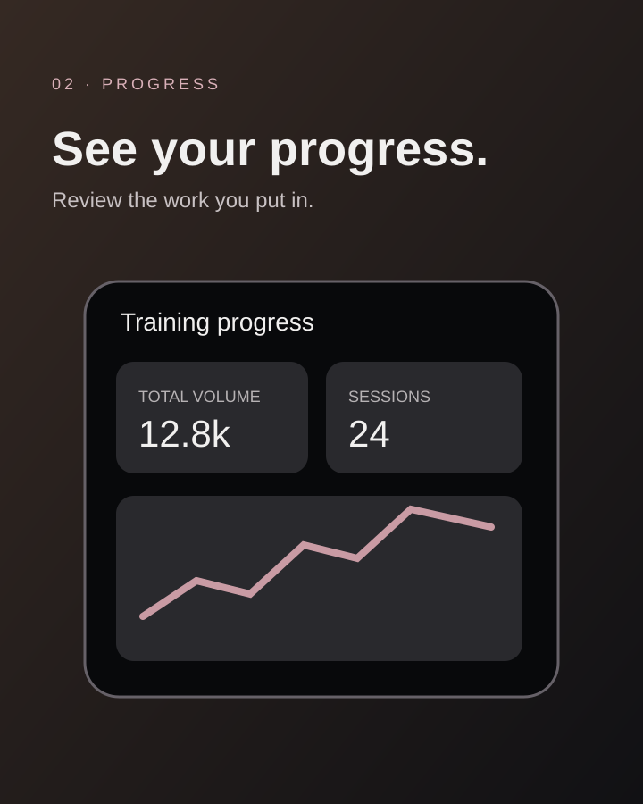
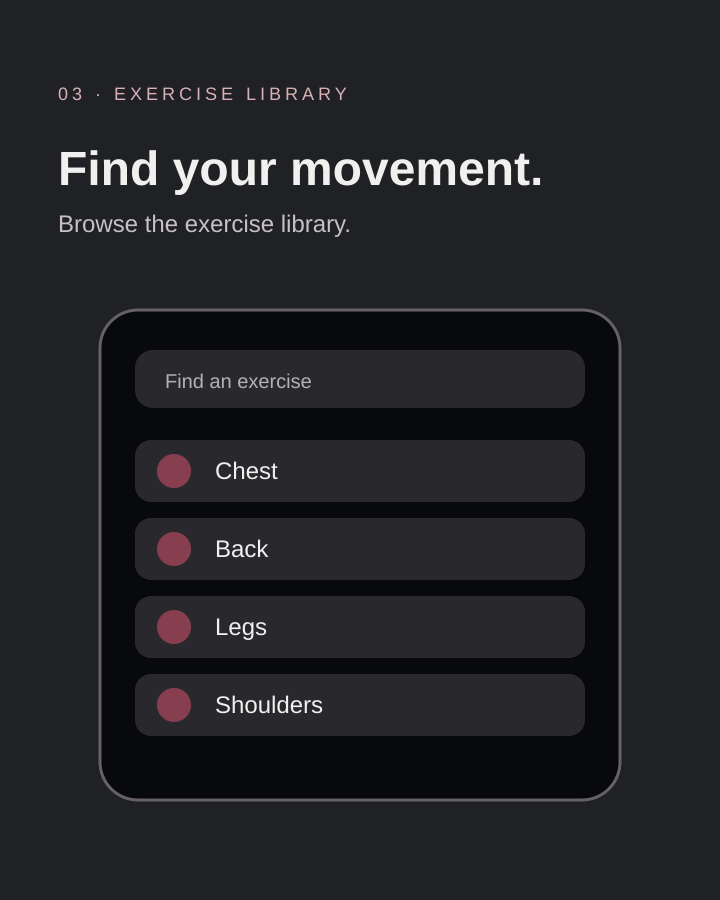

<div align="center">


<br>


# TREN

### TRAIN. EVOLVE. BECOME.

**A Flutter-based workout tracking application for Android.**

Plan workouts · Record training · Review progress


</div>

---

## 1. About the project

TREN is a mobile workout companion developed as a university project. It is designed to help users organize their gym training, record workout sessions and review their training history.

The application is built with **Flutter** and **Dart**, with **Android as its only target platform**. Its visual design uses a dark charcoal background with burgundy accents to keep the interface consistent and easy to read.

## 2. Main features

<div align="center">

| Workout tracking | Training progress |
|:---:|:---:|
|  |  |
| Record exercises, sets, repetitions and weights. | Review your workout history and performance. |

| Exercise library | Workout routines |
|:---:|:---:|
|  |  |
| Browse exercises and their details. | Organize exercises into repeatable plans. |

</div>

*The panels above are illustrative artwork. The actual interface and available features are defined by the current application build.*

## 3. Technology used

| Technology | Purpose |
|---|---|
| Flutter | Cross-platform UI toolkit used with Android as the project target |
| Dart | Main programming language |
| Android SDK | Android application build and runtime |
| Gradle | Android build configuration |

## 4. Getting started

Follow these steps to run TREN on your computer.

### Step 1 — Install the required software

Before starting, install:

- [Flutter SDK](https://docs.flutter.dev/get-started/install)
- [Android Studio](https://developer.android.com/studio)
- Android SDK and Android platform tools
- Git

After installation, open a terminal and check your setup:

```bash
flutter doctor
```

Resolve any Android toolchain issues reported by Flutter before continuing.

### Step 2 — Download the project

Open PowerShell, Command Prompt or a terminal and run:

```bash
git clone https://github.com/Code-till-nirvana/tren.git
cd tren
```

### Step 3 — Install project dependencies

From the project folder, run:

```bash
flutter pub get
```

### Step 4 — Connect an Android device

You can use either:

- A physical Android phone with USB debugging enabled, or
- An Android Virtual Device (AVD) created in Android Studio.

Check that Flutter detects your device:

```bash
flutter devices
```

### Step 5 — Run the application

```bash
flutter run
```

Flutter will build and launch TREN on the selected Android device or emulator.

## 5. Build an APK

To create a release APK, run:

```bash
flutter build apk --release
```

After a successful build, find the APK here:

```text
build/app/outputs/flutter-apk/app-release.apk
```

You can copy this APK to an Android phone and install it. For local testing, make sure the device allows installation from the location where the APK is stored.

## 6. Useful development commands

| Command | What it does |
|---|---|
| `flutter pub get` | Downloads the project's Dart and Flutter dependencies |
| `flutter devices` | Lists connected Android devices and emulators |
| `flutter run` | Runs the app in debug mode |
| `dart format lib test` | Formats Dart source and test files |
| `flutter analyze` | Checks the project for static analysis issues |
| `flutter test` | Runs automated tests |
| `flutter clean` | Removes generated build files |
| `flutter build apk --release` | Builds the Android release APK |

## 7. Project folder overview

The main folders and files you will work with are:

```text
tren/
├── android/       Android-specific app and build configuration
├── assets/        Images, icons, fonts and other app resources
├── docs/          Project documentation and README artwork
├── lib/           Main Flutter and Dart application code
├── test/          Automated tests
├── pubspec.yaml   Project dependencies and asset declarations
└── README.md      Project documentation
```

Most application changes will be made inside the **lib/** directory. Android package settings, permissions and build configuration are maintained inside **android/**.

## 8. Design colours

TREN uses a charcoal and burgundy colour palette.

| UI element | Hex colour |
|---|---|
| Main background | `#202124` |
| Primary card | `#29292D` |
| Secondary surface | `#37363B` |
| Primary burgundy | `#873F50` |
| Secondary burgundy | `#B87988` |
| Highlight | `#C99BA4` |
| Main text | `#F1F0EF` |
| Secondary text | `#B6B2B4` |

## 9. Troubleshooting

**Flutter command is not recognized**

Make sure the Flutter SDK's `bin` directory has been added to your system PATH. Restart your terminal and run `flutter doctor` again.

**No Android device is listed**

Start an Android emulator or connect a phone with USB debugging enabled. Then run `flutter devices`.

**Dependencies or build files seem out of date**

Try:

```bash
flutter clean
flutter pub get
flutter run
```

**The Android build fails**

Read the first error reported in the terminal, check the installed Android SDK and Java/Gradle requirements, then run `flutter doctor -v`.

## 10. Project information

| Item | Details |
|---|---|
| Project name | TREN |
| Project type | University / academic project |
| Application ID | `com.tren.app` |
| Target platform | Android |
| Framework | Flutter |
| Language | Dart |
| Repository | [Code-till-nirvana/tren](https://github.com/Code-till-nirvana/tren) |

## Acknowledgements

This project uses open-source software and third-party resources. Licence terms and required notices are retained in the repository's [LICENSE](LICENSE), [ADDITIONAL_TERMS.md](ADDITIONAL_TERMS.md) and [CREDITS.md](CREDITS.md) files. The upstream covered work is attributed to **GymMane by InlitX**.

---

<div align="center">

**TREN — TRAIN. EVOLVE. BECOME.**

<sub>Developed as a university project.</sub>

</div>
