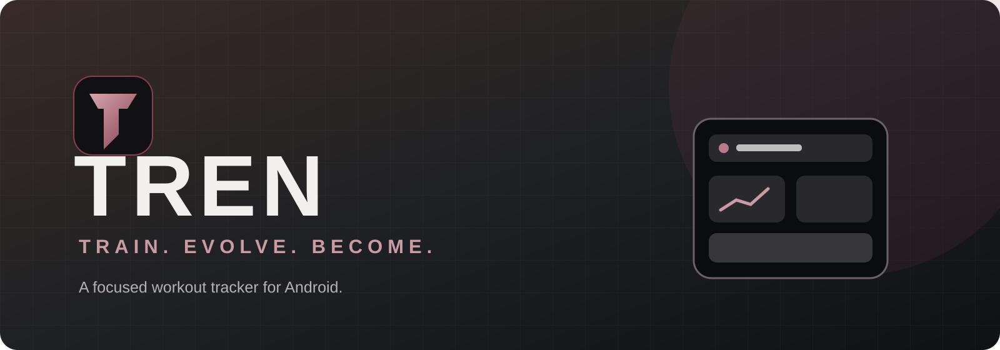
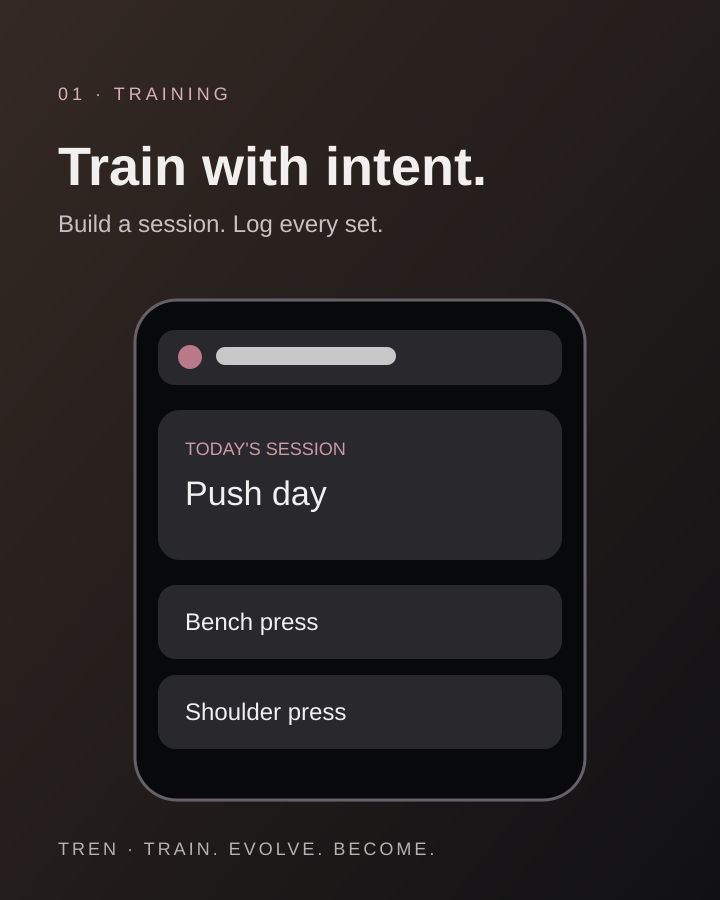
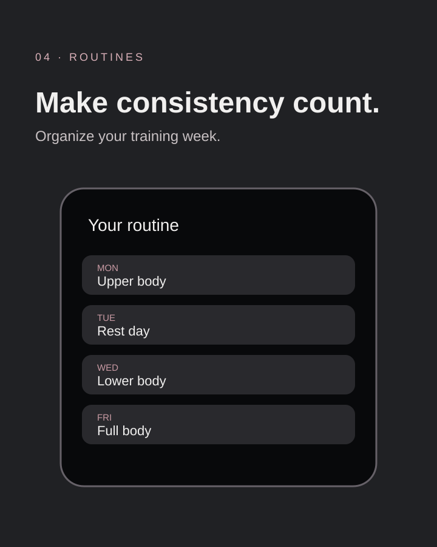

# TREN

<div align="center">




### TRAIN. EVOLVE. BECOME.

**A focused workout tracker for Android.**


</div>

---

## YOUR TRAINING, IN FOCUS

TREN is an Android workout companion built to help keep training organized. Record sessions, explore exercises, shape routines and look back at your progress in a clean charcoal-and-burgundy interface.

<div align="center">

| **TRAIN WITH INTENT** | **SEE YOUR PROGRESS** |
|:---:|:---:|
|  |  |
| Build a session. Log each set. | Review the work you put in. |

| **FIND YOUR MOVEMENT** | **MAKE CONSISTENCY COUNT** |
|:---:|:---:|
|  |  |
| Explore the exercise library. | Organize your training week. |

<sub>Feature illustrations. Replace with actual app screenshots as the Android UI is finalized.</sub>

</div>

## WHAT TREN IS BUILT AROUND

<table>
<tr>
<td width="50%" valign="top">

### 🏋️ Workout logging

- Record training sessions.
- Log exercises, sets, repetitions and weights.
- Keep workouts organized.
- Review previous sessions.

</td>
<td width="50%" valign="top">

### 📈 Training progress

- Follow your training history.
- Review exercise performance.
- Track activity over time.
- Use past sessions to guide future training.

</td>
</tr>
<tr>
<td width="50%" valign="top">

### 💪 Exercise library

- Browse available exercises.
- Explore muscle groups and equipment.
- View exercise details and instructions.
- Find movements for your sessions.

</td>
<td width="50%" valign="top">

### 📅 Routines

- Organize exercises into routines.
- Structure recurring training days.
- Revisit saved plans.
- Build a consistent training schedule.

</td>
</tr>
</table>

## VISUAL IDENTITY

| Role | Colour |
|---|---|
| Main background | `#202124` |
| Primary surface | `#29292D` |
| Raised surface | `#37363B` |
| Burgundy | `#873F50` |
| Rose accent | `#B87988` |
| Highlight | `#C99BA4` |
| Main text | `#F1F0EF` |
| Secondary text | `#B6B2B4` |

## ANDROID APP

| Detail | Value |
|---|---|
| App name | TREN |
| Tagline | TRAIN. EVOLVE. BECOME. |
| Platform | Android only |
| Application ID | `com.tren.app` |
| Framework | Flutter |
| Language | Dart |

## GET STARTED

### Requirements

- Flutter SDK compatible with the project
- Android Studio or Android SDK command-line tools
- Android emulator or physical Android device

### Clone and run

```bash
git clone https://github.com/Code-till-nirvana/tren.git
cd tren
flutter pub get
flutter run
```

### Build a release APK

```bash
flutter analyze
flutter test
flutter build apk --release
```

APK output:

```text
build/app/outputs/flutter-apk/app-release.apk
```

## PROJECT STRUCTURE

```text
tren/
├── android/       Android application and Gradle files
├── assets/        Application assets
├── docs/          Project documentation and README artwork
├── lib/           Flutter application source
├── test/          Automated tests
├── pubspec.yaml   Flutter dependencies and assets
└── README.md
```

## DEVELOPMENT STATUS

TREN is a college project under active development. Features and screens are being refined as the Android application evolves. Run the checks above before treating a build as release-ready.

## PRIVACY AND PERMISSIONS

Android permissions should be limited to the capabilities used by the app. Review the Android manifest and runtime permission prompts when changing functionality.

## THIRD-PARTY SOFTWARE AND LICENCE NOTICES

This project includes third-party and upstream open-source components. Their applicable licence notices, additional terms and attribution requirements are retained in the repository.

- [GPL-3.0 licence](LICENSE)
- [Additional terms](ADDITIONAL_TERMS.md)
- [Third-party asset credits](CREDITS.md)

Required attribution for the upstream covered work: **Based on GymMane by InlitX**.

---

<div align="center">

### TREN

**TRAIN. EVOLVE. BECOME.**

<sub>Built for consistency. Designed for progress.</sub>

</div>
